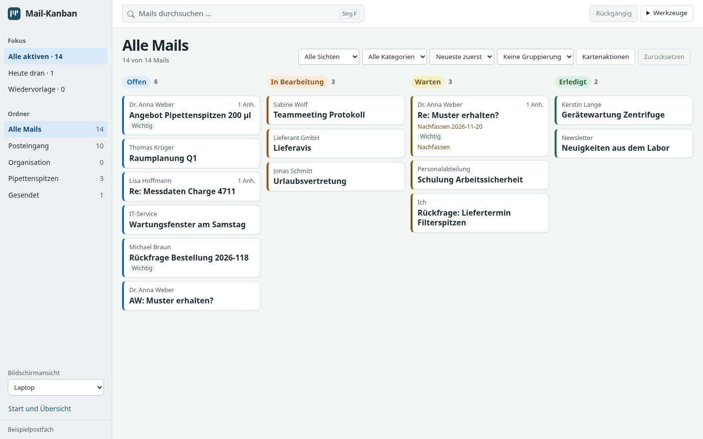

# Mail-Board für klassisches Outlook

Mail-Board ist eine eigenständige Windows-App für das tägliche Sichten, Nachverfolgen und Ablegen von E-Mails. Links stehen Postfach und Fokusansichten, in der Mitte die vier Statusspalten. Lesen, Antworten und Senden erfolgen in Outlook. Das Board kann Entwürfe in Outlook öffnen.



## Unter Windows ausprobieren

1. [Windows-x64-ZIP herunterladen](downloads/Mail-Board-Windows-x64.zip?raw=true) und den **gesamten Inhalt** in einen beschreibbaren Ordner entpacken.
2. **Mail-Board.exe** starten. Der erste Start zeigt ein Demo-Postfach. **Outlook-Mails laden** öffnet das Board für das vorhandene Outlook-Profil. Der mitgelieferte Helfer muss neben der EXE liegen.
3. Unter **Werkzeuge → Projektordner verwalten** einen vorhandenen Testordner als Board- und Lernziel wählen. Unter **Werkzeuge → Outlook und lokale KI** „Echte Mails verschieben erlauben“ einschalten.
4. Eine entbehrliche Testmail mit einem zum Ordner passenden Betreff anklicken, **Ablagevorschlag ermitteln**, das Ziel prüfen und die Verschiebung bestätigen. In Outlook den Zielordner prüfen. Im Board **Aktualisieren**, dann **Strg+Z** drücken und in Outlook den Ursprungsordner prüfen.

Der normale Start aus dem entpackten Ordner benötigt keine Administratorrechte, keinen Rust- oder Node-Dienst und keine Installation der App. Er setzt eine nutzbare **Microsoft Edge WebView2 Runtime** voraus. Für echte Mails benötigt der Helfer **klassisches Outlook für Windows** mit eingerichtetem Standardprofil und **.NET Framework 4.8**. Auf verwalteten Geräten gelten die lokalen Ausführungsrichtlinien für heruntergeladene Programme. Das neue Outlook für Windows stellt die verwendete COM-Schnittstelle nicht bereit.

## Bedienung und lokale Daten

- **F1** öffnet die Hilfe, **Strg+K** die Befehlspalette, **Strg+F** die Suche. Über **Start** sind unter anderem Wochenblick und Posteingang aufräumen erreichbar. **1–4** ändert den Status ausgewählter Karten.
- **Strg+T** startet die Morgen-Triage direkt auf dem Board: Ein Banner mit Briefing führt durch „Heute dran“, „Offen durchgehen“ und „Rest parken“. **F** nimmt markierte Karten in den Fokus (Outlook-Kategorie „Fokus“). Unter **Werkzeuge** liegen Wochenkalender, Vorgänge mit Checklisten und Routinen. Details stehen in den [Erweiterungen 0.16–0.20](docs/ERWEITERUNGEN.md).
- Ohne KI lassen sich Mails verarbeiten und Ablageziele anhand von Regeln, Steckbriefen und gelernten Beispielen vorschlagen. Wer die Modellfunktionen nutzen möchte, startet lokal Ollama, installiert ein passendes Modell und wählt es unter **Outlook und lokale KI** aus. Modellzugriffe laufen über Rust und sind auf Loopback beschränkt.
- **Werkzeuge → Lokale Daten und Textbausteine** exportiert und importiert Sicherungen. Die App speichert lokale Einstellungen im Benutzerprofil. Das bloße Kopieren der EXE auf einen anderen PC überträgt diese Daten nicht.

[Funktionsmatrix und Unterschiede zur Python-Version](docs/FUNKTIONSMATRIX.md) · [Erweiterungen 0.16–0.20](docs/ERWEITERUNGEN.md) · [Datenübernahme](docs/DATEN.md) · [Windows-Abnahme](docs/WINDOWS-ABNAHME.md) · [Designentscheidungen](DESIGN.md)

## Unter Windows selbst bauen

Voraussetzungen für den Build sind Node.js mit npm, Rust stable mit dem MSVC-Toolchain für x64, Visual Studio Build Tools mit C++ und Windows SDK sowie die WebView2 Runtime. Der C#-Helfer und seine Quellen liegen in outlook-test/. Für einen vollständigen Neubau vom Repository-Stamm aus in der Windows-Eingabeaufforderung ausführen:

```cmd
npm ci
outlook-test\build.cmd
npm test
npm run portable
```

Das Paket liegt anschließend unter `downloads/Mail-Board-Windows-x64.zip`. Für die Entwicklung startet `npm run dev` das Desktopfenster. `npm run build` prüft TypeScript und erzeugt die Weboberfläche in dist/.

### Automatisierte Prüfung

| Befehl | Prüft |
|---|---|
| `npm test` | Portierte Fachlogik, Ablage, Rücknahme, Ansichten und Datenübernahme |
| `cargo test --manifest-path src-tauri/Cargo.toml -p mailboard-ollama` | Lokales Modellprotokoll und Datenschutzgrenzen |
| `dotnet run --project outlook-test/tests/OutlookContracts.csproj` | C#-Helfer mit simuliertem Outlook, erfordert .NET SDK 8 für den Test |
| `python tests/live-board-smoke.py` | Regulärer Boardablauf mit simuliertem Desktop-Adapter, Bestätigung, Auffrischen und Undo |
| `python tests/board-keyboard-smoke.py` | Tastaturbedienung und Layout bis zur Mindestfenstergröße |
| `python tests/planning-smoke.py` | Morgen-Triage auf dem Board, Fokus, Routinen, Wochenkalender und Vorgänge, auch mit simuliertem Outlook |

Weitere Browsertests prüfen Morgen-Triage und Aufräumen, die Ordnerunterteilung, Projektabschluss und Rücknahme sowie Kartenaktionen und Antwortverfolgung. Unter Windows prüft [window-reopen.ps1](tests/window-reopen.ps1) das Wiederöffnen des Programmfensters.

Die Browsertests verwenden den vorausgegangenen Frontend-Build, Python mit Playwright und Chromium. Den Pfad zum installierten Browser kann man mit der Umgebungsvariable CHROMIUM setzen.
